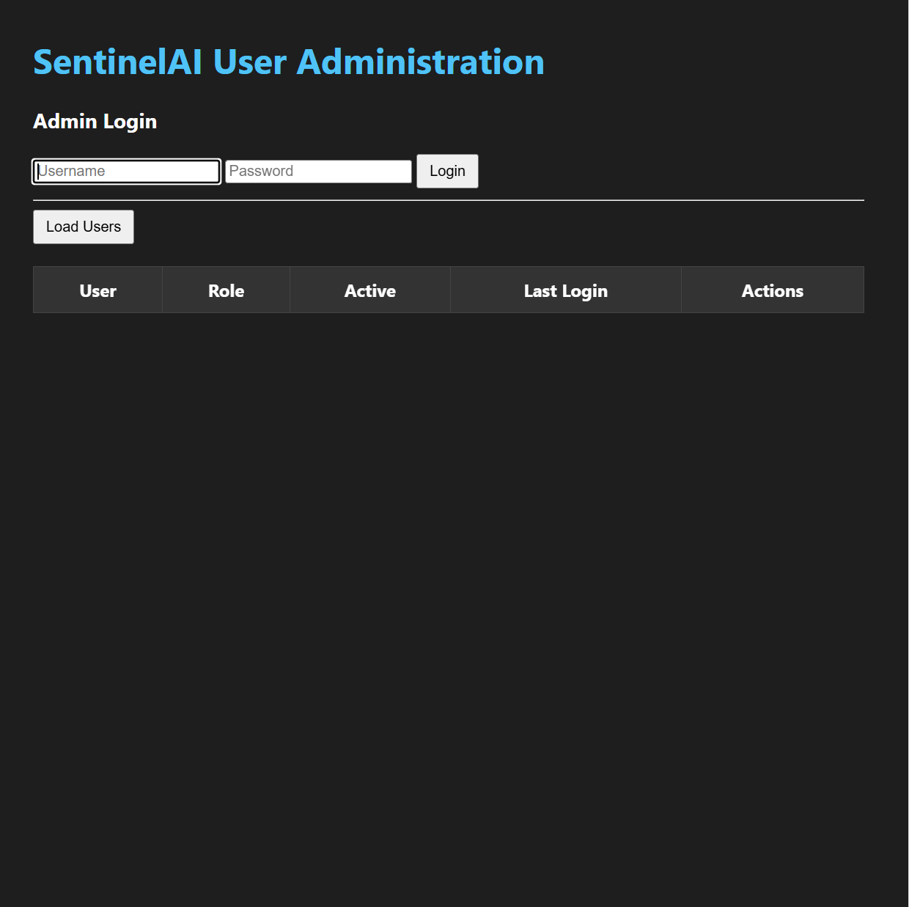
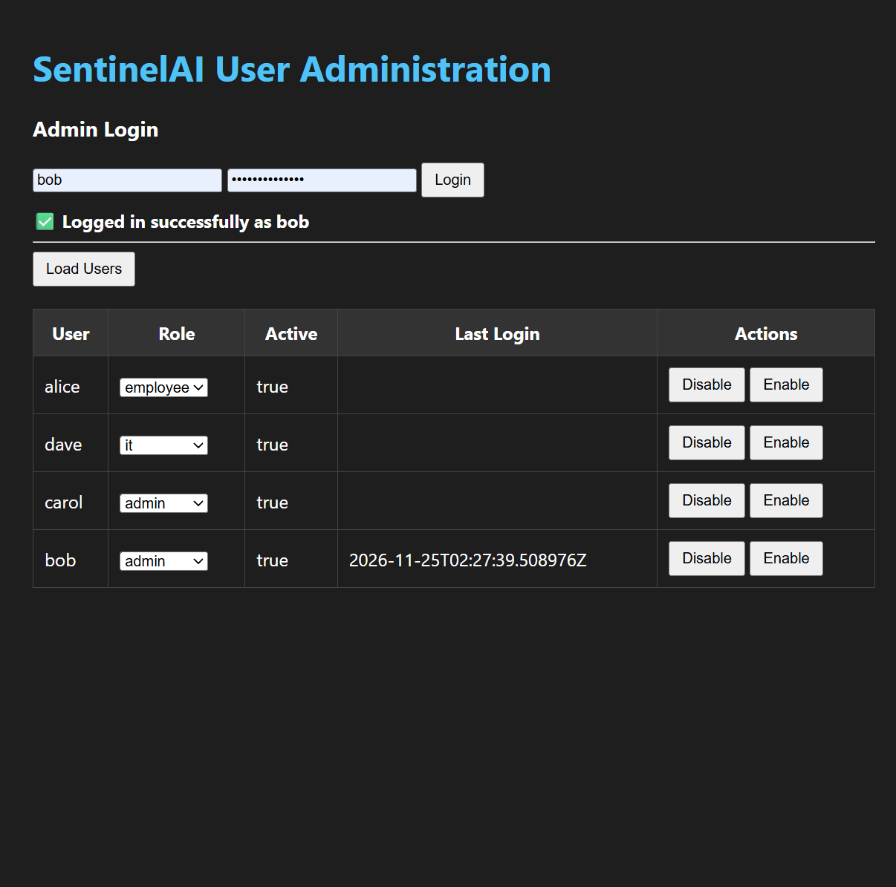
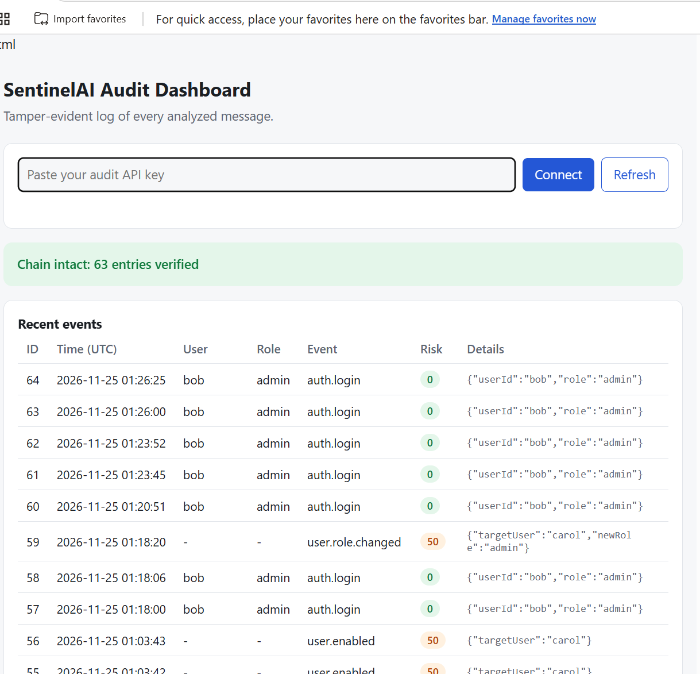

# SentinelAI
> A security-focused administration and auditing platform demonstrating secure authentication, role-based authorization, user administration, and tamper-evident audit logging using ASP.NET Core and PostgreSQL.

A security-focused administration and auditing platform built with ASP.NET Core and PostgreSQL.

SentinelAI demonstrates modern authentication, role-based access control (RBAC), user administration, and tamper-evident audit logging through a secure web-based administration portal and audit dashboard.

---

## Features

### Authentication

- JWT-based authentication
- Secure password hashing
- Login activity tracking
- Account enable/disable support

### Authorization

Role-Based Access Control (RBAC) with support for:

- Employee
- HR
- Finance
- IT
- Admin

### User Administration

- View users
- Enable user accounts
- Disable user accounts
- Modify user roles
- Track last login timestamps

### Audit System

- Tamper-evident audit chain
- Audit verification endpoint
- Audit dashboard
- Login success logging
- Login failure logging
- Administrative action logging
- Chain integrity verification

### Administrator Portal

- Secure administrator login
- User management interface
- Role management
- Account status controls
- Activity visibility

---

## Screenshots

### Login Screen



Secure administrator authentication using JWT-based login and account validation.

### Admin Portal



Administrative interface for managing users, assigning roles, enabling or disabling accounts, and monitoring user activity.

### Audit Dashboard



Security audit dashboard displaying login events, administrative actions, chain verification status, and tamper-evident audit records.

---

## Technology Stack

### Backend

- ASP.NET Core
- C#
- Entity Framework Core
- PostgreSQL

### Security

- JWT Authentication
- Role-Based Authorization (RBAC)
- Password Hashing
- Audit Logging
- Tamper-Evident Records

### Frontend

- HTML
- CSS
- JavaScript

---

## Project Structure

```text
SentinelAPI
│
├── Controllers
├── Data
├── Models
├── Services
├── Security
├── Migrations
├── screenshots
├── Properties
└── wwwroot
    ├── admin.html
    └── dashboard.html
```

---

## Security Features

SentinelAI was designed to demonstrate practical security engineering concepts:

- JWT token authentication
- Secure password hashing
- Role-based access control
- User account lifecycle management
- Login activity tracking
- Administrative audit logging
- Tamper-evident audit chains
- Audit verification capabilities
- Protection of sensitive configuration through ASP.NET User Secrets

---

## Security Principles Demonstrated

- Principle of Least Privilege
- Defense in Depth
- Separation of Duties
- Secure Secret Management
- Authentication and Authorization Controls
- Auditability and Accountability

---

## Admin Portal

The Admin Portal provides administrators with the ability to:

- Manage users
- Assign and change roles
- Enable or disable accounts
- Monitor user login activity
- Perform administrative actions with full audit logging

Access:

```text
/admin.html
```

---

## Audit Dashboard

The Audit Dashboard provides:

- Audit event history
- Security activity visibility
- Administrative event tracking
- Audit chain verification
- Integrity status monitoring

Access:

```text
/dashboard.html
```

---

## Running the Project

### Prerequisites

- .NET SDK
- PostgreSQL
- Visual Studio

### Setup

1. Clone the repository.

```bash
git clone <repository-url>
```

2. Create a PostgreSQL database.

3. Configure ASP.NET User Secrets.

4. Run Entity Framework migrations.

```bash
dotnet ef database update
```

5. Start the application.

```bash
dotnet run
```

---

## Application Access

### Admin Portal

```text
https://localhost:7198/admin.html
```

### Audit Dashboard

```text
https://localhost:7198/dashboard.html
```

---

## Development Notes

Sensitive information is stored using ASP.NET User Secrets and is never committed to source control.

Examples include:

- JWT signing keys
- Audit API keys
- Database credentials
- Demo account passwords

---

## Future Enhancements

- Session persistence
- Logout functionality
- Password reset workflows
- Audit export capabilities
- Azure deployment
- Single Sign-On (SSO)
- Multi-Factor Authentication (MFA)
- Refresh token support
- Docker deployment
- AI-powered audit analysis

---

## License

Copyright © 2026 Anthony Wade Ayres

All Rights Reserved.

SentinelAI is provided for portfolio, evaluation, and demonstration purposes only.

No part of this software may be copied, modified, distributed, sublicensed, sold, or used for commercial purposes without prior written permission from the author.

For commercial licensing, consulting, customization, or deployment inquiries, please contact the author.
---

## Commercial Licensing

SentinelAI is available for demonstration, educational, and portfolio purposes.

Organizations interested in commercial licensing, customization, consulting services, or enterprise deployment support may contact the author to discuss:

- Commercial licensing
- Custom feature development
- Security enhancements
- Cloud deployment services
- Integration with existing systems
- AI-powered compliance and audit capabilities

For business inquiries, please contact:

**Anthony Wade Ayres**

Email: tonywade1812@gmail.com

---

## Enterprise Opportunities

SentinelAI provides a foundation for:

- User Identity Management
- Administrative Control Portals
- Compliance Auditing
- Security Event Monitoring
- Internal Governance Systems
- Role-Based Access Control (RBAC)
- Audit Trail Verification

Enterprise-specific functionality can be developed based on organizational requirements.